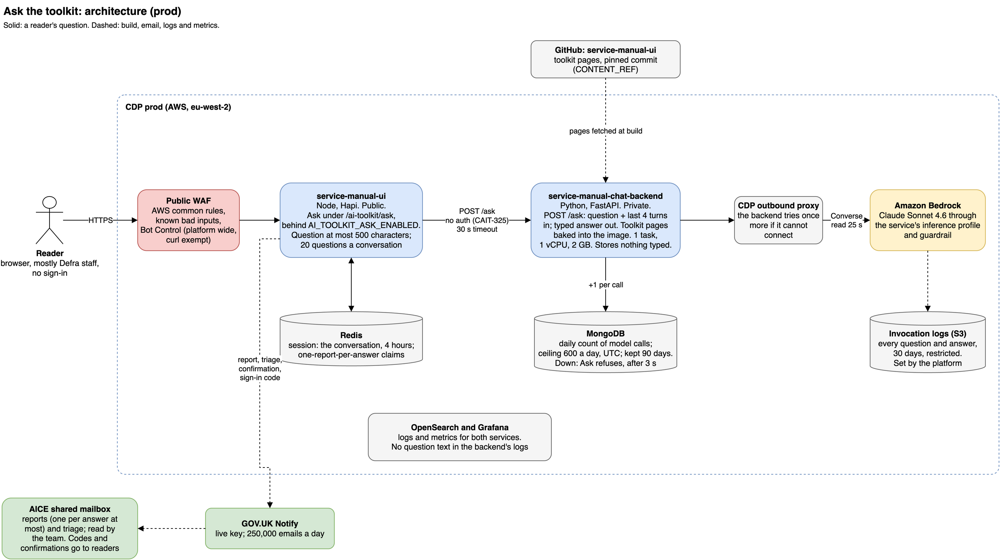

# Ask the toolkit: architecture

How Ask the toolkit fits together on CDP, as released. As of 17 November 2026.
For what to do when something goes wrong, see [the runbook](runbook.md).

Solid lines are a reader's question; dashed lines are the build, email, logs and
metrics. The source is [`architecture.drawio`](architecture.drawio): edit it in
draw.io and export a PNG with the same name, at scale 2.

## The parts

| Part | What it does |
| :-- | :-- |
| service-manual-ui | The Defra AI Toolkit site (Node, Hapi). Serves Ask at `/ai-toolkit/ask` when `AI_TOOLKIT_ASK_ENABLED` is on. Keeps the conversation, checks each answer's quotes and sources again before showing it, and sends problem reports through GOV.UK Notify. |
| service-manual-chat-backend | This repo (Python, FastAPI). One endpoint, `POST /ask`: takes a question and the last 4 turns, and returns a typed answer. Not reachable from the internet. |
| Amazon Bedrock | Claude Sonnet 4.6, through the service's own inference profile and guardrail in each environment. The backend's task role signs the calls; there is no key. |
| MongoDB | The day's count of model calls, for the daily ceiling. Nothing else. |
| Redis | The site's session: the conversation, for 4 hours. |
| CDP outbound proxy | Every call to Bedrock goes through it. |

## What is kept, and where

- **The question and answer text** is kept in the site's Redis session for 4
  hours, and in Bedrock's invocation logs for 30 days. The platform runs those
  logs in a restricted S3 bucket; we cannot change them.
- **The backend keeps nothing a reader typed.** Its logs give lengths,
  statuses, token counts and the `trace.id`, never the question or answer.
- **MongoDB** holds one count per day, kept for 90 days.

## Design choices

These are the choices a maintainer is most likely to question.

- **The whole toolkit goes in the prompt.** Every page is sent with every
  question, and the prompt is cached so repeat calls are cheaper. There is no
  search index or vector store: the toolkit is small enough to send whole, so
  no search step can miss the page that holds the answer.
- **The toolkit pages are baked into the image** from service-manual-ui at the
  commit in `CONTENT_REF` (`Dockerfile`). A guidance change reaches Ask only
  when `CONTENT_REF` is bumped and the backend redeployed.
- **The answer is typed.** The model must return one of six statuses
  (`answered`, `need_more_detail`, `cannot_answer`, `talk_to_a_person`,
  `blocked`, `error`) with the fields that go with it. The site shows each
  status its own way.
- **Rules are quoted word for word.** The model explains around a rule and
  never rewords it. Both the backend and the site check that the quote is
  really on the page it names, and drop it if not.
- **The backend is stateless.** The conversation lives in the site's session;
  the site sends the last 4 turns with each question.
- **The call is synchronous.** The site waits up to 30 seconds for one answer.
  There is no streaming or polling.
- **The site calls the backend without a token.** Only services inside the
  platform can reach the backend, and the daily ceiling caps the cost. Adding
  authentication is CAIT-325.

## Locally

Running it on your machine differs from CDP in three ways. The toolkit pages are
mounted from a sibling checkout of service-manual-ui, so an edit shows on the
next question. Bedrock is reached with your own AWS credentials. There is no
inference profile and no guardrail. The README's "Try Ask the toolkit locally"
says how to set it up.
